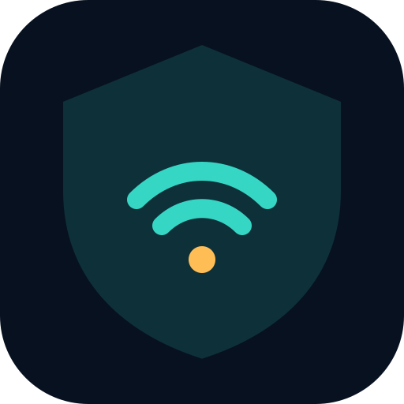

<div align="center">
  
  <h1>Vigía Suite Web</h1>
  <p><strong>Reconocimiento pasivo y análisis defensivo con ESP32.</strong></p>
  <p>
    <a href="https://vigia-suite-web-pc-lab.vercel.app"></a>
    <a href="https://github.com/LuisNafate/vigia-suite-web"></a>
    <a href="https://github.com/LuisNafate/vigia-suite-android/releases/tag/v0.7.0-beta"></a>
  </p>
  <p>
    
    
    
    
    
    
    
  </p>
</div>

---

## Descripción

Suite defensiva web conectada a un sensor NodeMCU ESP-32S mediante USB. Este repositorio contiene la presentación, el laboratorio web, el firmware y las herramientas para preparar el sensor.

El informe combina inventario Wi-Fi y Bluetooth LE, puntuación contextual, hallazgos explicados y recomendaciones. La web conserva hasta 20 resúmenes en el navegador y exporta el informe completo como JSON o CSV.

## Enlaces rápidos

| Recurso | Acceso |
|---|---|
| Aplicación web | [Abrir Vigía Suite en Vercel](https://vigia-suite-web-pc-lab.vercel.app) |
| Laboratorio | [Abrir directamente el dashboard](https://vigia-suite-web-pc-lab.vercel.app/dashboard.html) |
| Aplicación Android | [Repositorio móvil](https://github.com/LuisNafate/vigia-suite-android) |
| APK de prueba | [Descargar 0.7.0 Beta](https://github.com/LuisNafate/vigia-suite-android/releases/tag/v0.7.0-beta) |
| Última actividad | [Historial de cambios](https://github.com/LuisNafate/vigia-suite-web/commits/main) |

## Hardware objetivo

- NodeMCU ESP-32S / NodeMCU-32S.
- Convertidor USB-UART CP2102 o CH340 integrado en la placa.
- Para PC: cable USB de datos.

El ESP-32S no tiene USB nativo. La comunicación pasa por el convertidor USB-UART de la placa a 115200 8N1.

## Funciones disponibles

- Validación del enlace con `PING`.
- Identidad de placa, chip y MAC con `INFO`.
- Memoria libre y tiempo activo con `STATUS`.
- Inventario Wi-Fi 2.4 GHz con `SCAN_WIFI`.
- Packet Metadata Monitor y detector pasivo de deauth/disassoc con `MONITOR_DEAUTH`; registran únicamente conteos, señal y BSSID, nunca contenido.
- Inspector de AP ocultos y detector de rogue AP mediante una línea base guardada localmente.
- Diagnóstico del radio Bluetooth con `BLE_STATUS`.
- Inventario Bluetooth Low Energy con `SCAN_BLE`: nombre, dirección y tipo de dirección, RSSI, cercanía estimada, conectividad, fabricante y servicios anunciados.
- Resumen de perfiles GATT anunciados y detección heurística de patrones Find My/AirTag sin conexión al dispositivo.
- Laboratorio controlado para revisar beacons, resistencia deauth/PMF y portal cautivo sin transmitir tramas ni recolectar credenciales.
- Deduplicación por dirección BLE y análisis de exposición de identificadores estables.
- Reinicio controlado con `REBOOT`.
- Límite de 32 resultados por análisis para proteger la memoria del sensor.
- Uso local: los resultados no se envían a Internet.
- Navegación por apartados: Inicio, Resumen, Redes Wi-Fi, Bluetooth y Sistema.
- Interfaz 0.8 monocromática con navegación lateral en escritorio, navegación compacta en móvil y acciones ordenadas por tarea.
- Cada herramienta incluye un apartado desplegable con su propósito, datos entregados, límites y orden recomendado de uso.
- Análisis guiado que ejecuta los módulos de forma secuencial y evita escaneos solapados.
- Puntuación de exposición, hallazgos priorizados y recomendaciones defensivas.
- Identificación explícita de análisis parciales cuando un módulo no responde.

## Preparar el ESP32 desde el navegador

No necesitas Arduino IDE, Arduino CLI ni compiladores. Solo Chrome o Edge en una computadora y, en Windows, el controlador USB de tu placa.

1. Abre el laboratorio (`dashboard.html`) y entra en **Preparar ESP32**.
2. Pulsa **Elegir puerto USB** y selecciona tu placa. La web nunca elige un puerto por su cuenta.
3. Vigía comprueba qué tiene la placa:
   - **Vigía compatible:** puedes usarla directamente con **Usar Vigía Suite**.
   - **Placa nueva, firmware desconocido o incompatible:** se ofrece la instalación.
4. Marca la casilla de confirmación y pulsa **Instalar firmware**. Antes de escribir, la web:
   - verifica el SHA-256 de cada archivo,
   - identifica el chip,
   - cancela si no es un ESP32 compatible.
5. Al terminar, el sensor se reinicia. Solo verás "instalación verificada" si responde con `ready` y el protocolo VIGIA/2.

Si tu placa no aparece en la lista de puertos, la sección incluye una guía con enlaces a los controladores oficiales de Silicon Labs (CP210x) y WCH (CH340).

El firmware oficial se publica en `pc-lab/firmware/` con su `manifest.json`. Para generar una versión nueva, consulta [docs/FIRMWARE-RELEASE.md](docs/FIRMWARE-RELEASE.md).

## Probar la versión web

1. Conecta el NodeMCU ESP-32S por USB y cierra el Monitor Serie de Arduino.
2. Abre la versión publicada o, en local, haz doble clic en `INICIAR-VIGIA.bat`.
3. La ruta `/` muestra la presentación cinematográfica del proyecto; desplázate para recorrer el despiece del ESP32.
4. Pulsa **Abrir laboratorio** para entrar en `dashboard.html`.
5. Si la placa todavía no tiene Vigía, usa **Preparar ESP32**. El helper local de **Sistema → Helper local (desarrollo)** sigue disponible solo para desarrolladores.
6. Pulsa **Conectar sensor**, autoriza el puerto y ejecuta los módulos de enlace, identidad, diagnóstico, Wi-Fi y Bluetooth.

Pruebas sin hardware: `npm test` (Node 20 o posterior, sin dependencias).

La portada usa 192 cuadros WebP del MP4 original: 1280×720 para escritorio y 768×432 para móvil. El desplazamiento controla el cuadro mostrado y funciona en ambos sentidos. Para regenerar las secuencias usa `scripts/extract-product-frames.ps1`.

El firmware queda guardado en la memoria flash del ESP32 y arranca automáticamente cada vez que recibe energía. La web también puede instalarse desde **Instalar Web App** en Edge.

Inicio manual:

```powershell
Set-ExecutionPolicy -Scope Process Bypass
.\scripts\start-pc-lab.ps1
```

## Aplicación Android

El código móvil y su descarga se publican por separado:

- [Repositorio Vigía Suite Android](https://github.com/LuisNafate/vigia-suite-android)
- [Descargar Android 0.7.0 Beta](https://github.com/LuisNafate/vigia-suite-android/releases/tag/v0.7.0-beta)

## Firmware manual

El código también puede abrirse en Arduino IDE:

```text
firmware/arduino/VigiaSensor/VigiaSensor.ino
```

Selecciona **ESP32 Dev Module**, **Partition Scheme: Huge APP (3MB No OTA/1MB SPIFFS)**, el puerto correspondiente y pulsa **Subir**. El asistente web selecciona esta partición automáticamente.

## Arquitectura

- Web/PWA: HTML, CSS y JavaScript; Web Serial para usar el sensor.
- Asistente local: PowerShell + Arduino CLI para detectar y preparar el ESP32.
- Android: repositorio independiente enlazado arriba.
- Firmware: Arduino-ESP32 con Wi-Fi y BLE.
- Protocolo VIGIA/2: comandos ASCII y eventos JSON Lines versionados.

## Uso responsable

Las funciones de descubrimiento deben utilizarse exclusivamente en redes, espacios y dispositivos propios o con autorización explícita. El proyecto realiza inventario y diagnóstico defensivo; no intenta autenticarse, interferir ni capturar contenido de terceros.
